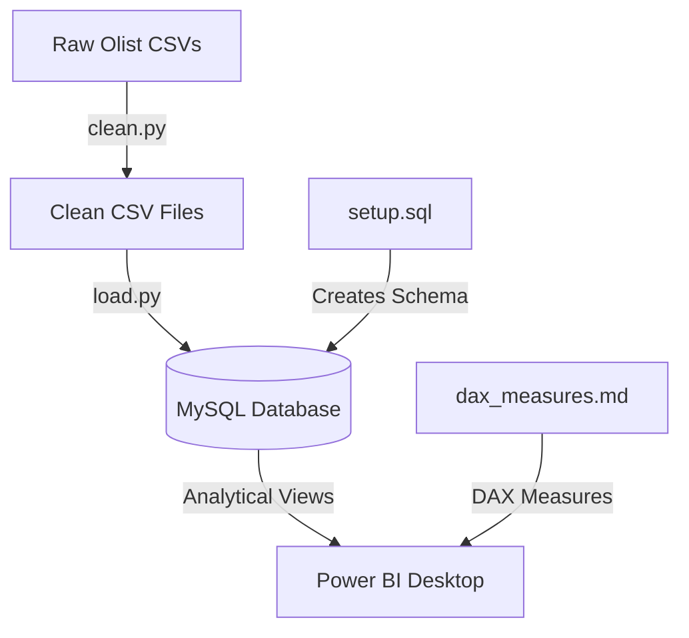

# RetailIQ — E-Commerce Analytics & Data Warehouse Pipeline

An end-to-end e-commerce data engineering and business intelligence project utilizing real transaction data from the **Olist Brazilian E-Commerce Dataset** (100k+ orders). 

This repository implements a complete star schema data pipeline: **Python (ETL/Cleaning) ➔ MySQL (Data Warehousing/Modeling) ➔ Power BI (Visualization & Business Insights)**.

> **Note:** The Olist dataset is used here **for demonstration purposes only**. The pipeline is not tied to Olist. Any transactional e-commerce dataset (orders, customers, products, sellers, payments) can be used by adapting the column mappings in `clean.py`.

---

## 📦 Dataset

**Olist Brazilian E-Commerce Public Dataset** — [kaggle.com/datasets/olistbr/brazilian-ecommerce](https://www.kaggle.com/datasets/olistbr/brazilian-ecommerce)

Real, anonymized commercial data from Olist, a Brazilian marketplace that connects small businesses to major online sales channels. It covers **~100k orders placed between 2016 and 2018** across multiple marketplaces in Brazil.

| File | Description | Approx. rows |
|---|---|---|
| `olist_orders_dataset.csv` | Order status and timestamps | 99k |
| `olist_order_items_dataset.csv` | Products, price and freight per order | 113k |
| `olist_order_payments_dataset.csv` | Payment type, installments, value | 104k |
| `olist_order_reviews_dataset.csv` | Customer review scores and comments | 99k |
| `olist_customers_dataset.csv` | Customer location and unique ID | 99k |
| `olist_products_dataset.csv` | Product category and dimensions | 33k |
| `olist_sellers_dataset.csv` | Seller location | 3k |
| `olist_geolocation_dataset.csv` | Zip code to latitude/longitude | 1M |
| `product_category_name_translation.csv` | Portuguese to English category names | 71 |

### Downloading the data

The raw files are not committed to this repo (they are git-ignored under `data/raw/`). To get them:

**Option A — Manual:** Download the zip from the Kaggle link above and extract all CSVs into `data/raw/`.

**Option B — Kaggle CLI:**
```powershell
pip install kaggle
kaggle datasets download -d olistbr/brazilian-ecommerce -p data/raw --unzip
```

The dataset is released under the [CC BY-NC-SA 4.0](https://creativecommons.org/licenses/by-nc-sa/4.0/) license. Credit goes to Olist for publishing it.

### Why this dataset?

* **Real volume (100k+ orders, 1.5M+ rows in total):** Large enough that query performance, indexing and ETL design matter. A toy dataset of a few hundred rows hides those problems.
* **Relational, multi-table structure:** Nine linked tables (orders, items, payments, reviews, customers, products, sellers, geography) map naturally to a star schema, with joins, deduplication and aggregation at realistic scale.
* **Real-world data quality problems:** Missing values, duplicate reviews, Portuguese category names, and the `customer_id` vs `customer_unique_id` trap. These make the cleaning and modeling work meaningful.
* **Rich business questions:** It supports revenue trends, RFM segmentation, delivery performance, seller scoring, payment behavior and geographic analysis, which covers the full analytics workflow.
* **Public and reproducible:** Anyone can download the same data from Kaggle and reproduce the results.

### Built to operate at scale

The architecture is not specific to this dataset's size. It is designed to carry over to much larger data:

* **Warehouse-side logic:** Business logic lives in SQL views (`vw_*`), so Power BI queries pre-aggregated results instead of crunching raw rows.
* **Star schema:** One fact table with narrow dimension tables is the standard model for fast analytical queries as row counts grow.
* **Indexing:** Indexes on join keys, date, year/month, state and RFM segment (`setup.sql`, Part 4) keep filters and joins fast as the fact table grows.
* **Batched loading:** `load.py` writes to MySQL in chunks, so memory use stays flat during loads.
* **Separation of layers:** Cleaning (Python), storage and modeling (MySQL) and presentation (Power BI) can each be scaled or swapped independently. For example, MySQL could be replaced with PostgreSQL, BigQuery or Snowflake without changing the dashboard design.

At the current 100k-order size the whole pipeline runs comfortably on a laptop. For data in the tens of millions of rows, the same design applies, but `clean.py` (which uses in-memory pandas) would need chunked processing or a distributed engine such as Spark.

---

## 🚀 Project Architecture & Workflow

The pipeline separates data engineering/database logic from the visualization layer, adhering to enterprise standards.



---

## 📂 Repository Structure

```text
DA-IGP/
├── data/                                   # Git-ignored, created locally
│   ├── raw/                                # Original Olist CSVs (you download these)
│   │   ├── olist_orders_dataset.csv
│   │   ├── olist_order_items_dataset.csv
│   │   ├── olist_order_payments_dataset.csv
│   │   ├── olist_order_reviews_dataset.csv
│   │   ├── olist_customers_dataset.csv
│   │   ├── olist_products_dataset.csv
│   │   ├── olist_sellers_dataset.csv
│   │   ├── olist_geolocation_dataset.csv
│   │   └── product_category_name_translation.csv
│   └── clean/                              # Auto-generated by clean.py (not present until it runs)
│       ├── fact_orders.csv
│       ├── dim_customers.csv
│       ├── dim_products.csv
│       └── dim_sellers.csv
├── clean.py                                # Step 1: clean, merge, RFM scoring -> data/clean/
├── load.py                                 # Step 3: load clean CSVs into MySQL
├── setup.sql                               # Schema, indexes and analytical views
├── run_database_setup.py                   # Optional helper that runs the SQL parts and loader in one go
├── dax_measures.md                         # Power BI DAX measures
├── notes.md                                # Concepts and interview talking points
├── requirements.txt                        # Python dependencies
├── .env                                    # Git-ignored, your MySQL credentials
├── .gitignore
└── README.md
```

> **Note:** The `data/` folder is not in the repository. You create `data/raw/` and add the downloaded CSVs. The `data/clean/` folder and its 4 files are **generated automatically once you run `clean.py`**.

* **[clean.py](clean.py)**: Python script that loads, cleans, and merges raw CSV files, resolves customer sessions to unique individuals, calculates RFM scores, and outputs cleaned files.
* **[load.py](load.py)**: Loads cleaned data into MySQL, using secure environment variables.
* **[setup.sql](setup.sql)**: Contains MySQL statements to initialize the database structure, apply index optimizations, and build analytical views.
* **[dax_measures.md](dax_measures.md)**: Documentation of Power BI DAX formulas (basic aggregation, time intelligence, CLV, and formatting strings).
* **[notes.md](notes.md)**: Detailed step-by-step notes, database concepts, and discussion talking points for interviews.

---

## 📊 Database Star Schema Design

The project organizes data into a star schema centered around a transactions fact table:

### Fact Table
* **`fact_orders`**: One record per order. Tracks order status, timestamps, revenue, freight, payment details, installments count, delivery duration, delivery status, and review ratings.

### Dimension Tables
* **`dim_customers`**: Unique customers with their city, state, recency, frequency, monetary value, and assigned RFM segments.
* **`dim_products`**: Cleaned product directory mapping Portuguese categories into English names and broad groups (e.g., *Home & Living*).
* **`dim_sellers`**: Sellers with their city and state.
* **`DateTable`**: Custom Power BI calendar table supporting time intelligence functions (YoY, MoM, MTD, YTD).

---

## 📈 Analytical SQL Views

Power BI connects directly to database views to query data. This keeps business logic inside the SQL warehouse rather than scattering it across dashboard files:
1. **`vw_monthly_revenue`**: Aggregates order year/month, total revenue, average order value (AOV), average review score, and late rates for trend line analysis.
2. **`vw_category_performance`**: Detailed breakdown of items sold, revenue share, and delivery metrics by product category.
3. **`vw_rfm_segments`**: Aggregates customer count, lifetime spend, and percentage contribution to overall revenue by RFM segment.
4. **`vw_state_performance`**: Geographical delivery days, late rates, and revenue metrics grouped by Brazilian state.
5. **`vw_seller_performance`**: Aggregated performance metrics for sellers (filtered to $\ge 10$ orders), classifying them into performance quadrants.
6. **`vw_payment_analysis`**: Breakdowns of payment methods, installment counts, and transaction volume shares.

---

## 🛠️ Setup & Installation

### 1. Prerequisites
* Python 3.10+ installed
* MySQL Server & MySQL Workbench installed and running
* Power BI Desktop installed (Windows only)

### 2. Environment Setup
Clone the repository and set up your Python virtual environment:
```powershell
# Navigate to the workspace
cd DA-IGP

# Create and activate virtual environment
python -m venv venv
.\venv\Scripts\Activate.ps1

# Install required dependencies
pip install -r requirements.txt
```

### 3. Database Credentials Configuration
Create a `.env` file in the root of the project to securely pass database configurations (this file is excluded from git):
```env
DB_USER=your_mysql_user
DB_PASSWORD=your_mysql_password
DB_HOST=localhost
DB_PORT=3306
DB_NAME=retailiq
```

---

## 🏃 Running the Pipeline

Follow the execution order below to populate the database:

### Step 1: Clean Raw Data
Place the raw Olist CSVs in `data/raw/` (see [Dataset](#-dataset) above) and execute the Python cleaning script:
```powershell
python clean.py
```
*Outputs: 4 cleaned CSV files stored under `data/clean/`.*

### Step 2: Initialize Database Schema
Execute the schema creation statements from the SQL script (Part 1 and Part 2) in MySQL Workbench, or pipe them via the shell:
```powershell
Get-Content setup.sql | mysql -u your_user -p
```
*This prepares the database structure and creates the tables.*

### Step 3: Populate Tables via Python
Load the cleaned CSV tables into the database using SQLAlchemy:
```powershell
python load.py
```
*Appends the cleaned records to the schemas.*

### Step 4: Add Indexes & Analytical Views
Run the remainder of the SQL statements in `setup.sql` (Part 4 onwards) in MySQL Workbench or re-run:
```powershell
Get-Content setup.sql | mysql -u your_user -p
```
*This creates the index optimizations and view logic.*

---

## 💡 Key Business Insights

* **The Repeat Customer Trap**: The dataset tracks both session keys (`customer_id`) and unique individuals (`customer_unique_id`). Analyzing sessions directly shows a **0% repeat rate**. By joining on unique individual keys, we identify the actual repeat purchase rate of **~3.2%**.
* **RFM Champions Contribution**: Customer segmentation shows that "Champions" and "Loyal Customers" represent under **40%** of the customer base but account for over **55%** of overall revenue.
* **Problem Sellers**: The scatter analysis quadrants mapping `on_time_pct` against `avg_review_score` isolates a segment of "Problem Sellers" (low on-time rate + low review scores), providing actionable targets for vendor success operations.
