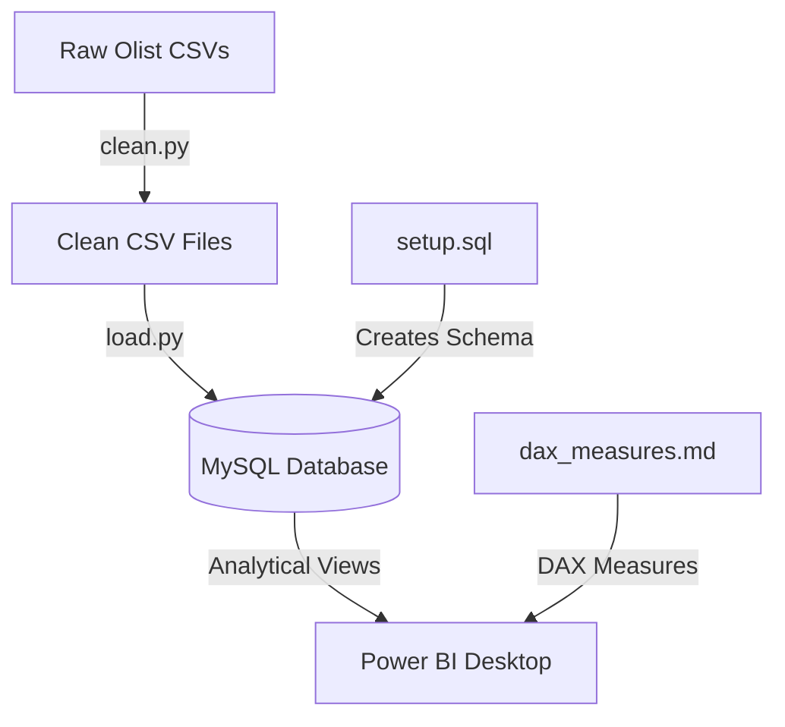

# RetailIQ — E-Commerce Analytics & Data Warehouse Pipeline

An end-to-end e-commerce data engineering and business intelligence project utilizing real transaction data from the **Olist Brazilian E-Commerce Dataset** (100k+ orders). 

This repository implements a complete star schema data pipeline: **Python (ETL/Cleaning) ➔ MySQL (Data Warehousing/Modeling) ➔ Power BI (Visualization & Business Insights)**.

---

## 🚀 Project Architecture & Workflow

The pipeline separates data engineering/database logic from the visualization layer, adhering to enterprise standards.



---

## 📂 Repository Structure

* **[clean.py](file:///c:/Users/hp/OneDrive/Desktop/DA-IGP/clean.py)**: Python script that loads, cleans, and merges raw CSV files, resolves customer sessions to unique individuals, calculates RFM scores, and outputs cleaned files.
* **[load.py](file:///c:/Users/hp/OneDrive/Desktop/DA-IGP/load.py)**: Loads cleaned data into MySQL, using secure environment variables.
* **[setup.sql](file:///c:/Users/hp/OneDrive/Desktop/DA-IGP/setup.sql)**: Contains MySQL statements to initialize the database structure, apply index optimizations, and build analytical views.
* **[dax_measures.md](file:///c:/Users/hp/OneDrive/Desktop/DA-IGP/dax_measures.md)**: Documentation of Power BI DAX formulas (basic aggregation, time intelligence, CLV, and formatting strings).
* **[notes.md](file:///c:/Users/hp/OneDrive/Desktop/DA-IGP/notes.md)**: Detailed step-by-step notes, database concepts, and discussion talking points for interviews.

---

## 📊 Database Star Schema Design

The project organizes data into a star schema centered around a transactions fact table:

### Fact Table
* **`fact_orders`**: One record per order. Tracks order status, timestamps, revenue, freight, payment details, installments count, delivery duration, delivery status, and review ratings.

### Dimension Tables
* **`dim_customers`**: Unique customers with their city, state, recency, frequency, monetary value, and assigned RFM segments.
* **`dim_products`**: Cleaned product directory mapping Portuguese categories into English names and broad groups (e.g., *Home & Living*).
* **`dim_sellers`**: Sellers with their city and state.
* **`DateTable`**: Custom Power BI calendar table supporting time intelligence functions (YoY, MoM, MTD, YTD).

---

## 📈 Analytical SQL Views

Power BI connects directly to database views to query data. This keeps business logic inside the SQL warehouse rather than scattering it across dashboard files:
1. **`vw_monthly_revenue`**: Aggregates order year/month, total revenue, average order value (AOV), average review score, and late rates for trend line analysis.
2. **`vw_category_performance`**: Detailed breakdown of items sold, revenue share, and delivery metrics by product category.
3. **`vw_rfm_segments`**: Aggregates customer count, lifetime spend, and percentage contribution to overall revenue by RFM segment.
4. **`vw_state_performance`**: Geographical delivery days, late rates, and revenue metrics grouped by Brazilian state.
5. **`vw_seller_performance`**: Aggregated performance metrics for sellers (filtered to $\ge 10$ orders), classifying them into performance quadrants.
6. **`vw_payment_analysis`**: Breakdowns of payment methods, installment counts, and transaction volume shares.

---

## 🛠️ Setup & Installation

### 1. Prerequisites
* Python 3.10+ installed
* MySQL Server & MySQL Workbench installed and running
* Power BI Desktop installed (Windows only)

### 2. Environment Setup
Clone the repository and set up your Python virtual environment:
```powershell
# Navigate to the workspace
cd DA-IGP

# Create and activate virtual environment
python -m venv venv
.\venv\Scripts\Activate.ps1

# Install required dependencies
pip install -r requirements.txt
```

### 3. Database Credentials Configuration
Create a `.env` file in the root of the project to securely pass database configurations (this file is excluded from git):
```env
DB_USER=your_mysql_user
DB_PASSWORD=your_mysql_password
DB_HOST=localhost
DB_PORT=3306
DB_NAME=retailiq
```

---

## 🏃 Running the Pipeline

Follow the execution order below to populate the database:

### Step 1: Clean Raw Data
Place your raw Olist CSVs in `data/raw/` and execute the Python cleaning script:
```powershell
python clean.py
```
*Outputs: 4 cleaned CSV files stored under `data/clean/`.*

### Step 2: Initialize Database Schema
Execute the schema creation statements from the SQL script (Part 1 and Part 2) in MySQL Workbench, or pipe them via the shell:
```powershell
Get-Content setup.sql | mysql -u your_user -p
```
*This prepares the database structure and creates the tables.*

### Step 3: Populate Tables via Python
Load the cleaned CSV tables into the database using SQLAlchemy:
```powershell
python load.py
```
*Appends the cleaned records to the schemas.*

### Step 4: Add Indexes & Analytical Views
Run the remainder of the SQL statements in `setup.sql` (Part 4 onwards) in MySQL Workbench or re-run:
```powershell
Get-Content setup.sql | mysql -u your_user -p
```
*This creates the index optimizations and view logic.*

---

## 💡 Key Business Insights

* **The Repeat Customer Trap**: The dataset tracks both session keys (`customer_id`) and unique individuals (`customer_unique_id`). Analyzing sessions directly shows a **0% repeat rate**. By joining on unique individual keys, we identify the actual repeat purchase rate of **~3.2%**.
* **RFM Champions Contribution**: Customer segmentation shows that "Champions" and "Loyal Customers" represent under **40%** of the customer base but account for over **55%** of overall revenue.
* **Problem Sellers**: The scatter analysis quadrants mapping `on_time_pct` against `avg_review_score` isolates a segment of "Problem Sellers" (low on-time rate + low review scores), providing actionable targets for vendor success operations.
